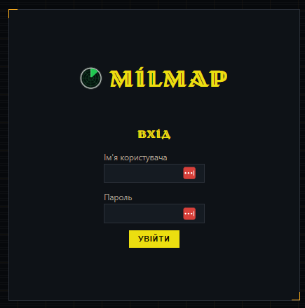

# Milmap — Asset Inventory & Compliance Management Dashboard

<p align="center">
  
</p>

**Milmap** is an internal, **air-gapped** local web application for **Network
Systems Administrators** to inventory their own internal infrastructure and audit
its security-compliance posture. It is a **defensive network-administration
tool**, operated only against authorized, internally owned assets, with **no
internet access at install time or at runtime** — a deliberate design constraint,
not a missing feature.

The full product specification is consolidated in
[`specs/v1.0/spec.md`](specs/v1.0/spec.md)

---

## Main idea

Know what is on your network, what it runs, and whether any of it is out of date
or still exposed with factory-default credentials — all **entirely offline**.

An administrator defines reusable **Asset Discovery Profiles** that orchestrate
`nmap` against an internal target scope, runs them on demand or on a schedule,
and reviews the results in a tactical-HUD dashboard. Two compliance controls then
grade each discovered asset:

- **Version/firmware validity** — checked **100% offline** against a locally
  maintained minimum-version threshold per product.
- **Default credentials** — a strictly **device-safe**, guarded check that
  confirms whether a device still accepts known factory-default credentials.

Everything is persisted, audited, and served from a single local process on a
single host. Because the environment is air-gapped, every reference dataset is
maintained and updated locally.

---

## Features

### Authentication, roles & access control

- **Strict local authentication** — username + password with a **≥20-character**
  policy enforced at creation and every change. No external identity provider.
- **Sign-in throttling / lockout**, **idle-timeout sessions**, explicit sign-out.
- **Two roles — Administrator and Operator** (no read-only viewer). The first
  account on a fresh install is Administrator; later accounts default to Operator.
  Administrators manage users, session/security settings, and the NSE allow-list;
  Operators do all discovery work, run the tools, and manage the version
  dictionary. The deployment can never be left with no active Administrator, and
  the 20-character floor can never be lowered.

### Asset Discovery Profiles & scanning

- **Full profile CRUD** with an **Edit** button; edits are conflict-protected (no
  silent overwrite).
- **Full control over the scan command** — timing template defaults to `T3`
  (changeable T0–T5), independent *extract-open-ports* / *extract-service-version*
  toggles, and an **exact effective-command preview**. The command is composed
  **only from a vetted allow-list** — a raw/free-form flag string is never
  accepted (command-injection guard).
- **NSE scripts** selectable from an Administrator-maintained allow-list; output
  is captured per host; off-list scripts can never run.
- **Target-optional profiles** — a profile may be saved without a target and used
  as a reusable template; the target is supplied at launch (for that run only).
- **Scan Configuration window** — every *Run now* opens a profile-editor-like
  review step (target / ports / timing / extracted fields + live preview +
  **Start Scan**); one-off adjustments never write back to the profile.
- **Adaptive results table** — small scans (≤10 ports) show each port's state;
  large scans show only open ports; a filtered/closed port is never shown as open;
  service version is read from an open port.

### Home dashboard, history & caching

- **Home ("Головна")** — a two-column overview: the 5 most-recently-updated
  profiles (each runnable) and the soonest scheduled tasks on the left; the 20
  most-recent scans across *all* profiles on the right. Compliance posture is
  shown where evaluated, "not applicable" otherwise — the landing page is useful
  even with no compliance configured.
- **Persistent history** — every run is stored and openable to its captured
  results; a **freshness-window cache** avoids redundant scans (with a *force
  fresh* override); a configurable **retention policy** applies predictably.
  Deleting a profile keeps its historical runs.
- **Dynamic UI** — lists update after a mutation (create/edit/duplicate/delete)
  without a manual browser reload.

### Scheduling

- **One shared scheduling engine** for both profile scans and the credential tool.
- A schedule **references a profile**, carries **its own target** (so target-less
  profiles are schedulable) and an optional label; a profile may have **multiple**
  schedules; schedules are editable in place and can be created from a past run.
- **Recurrence** is **once** (a calendar day + hour 0–23 + minute, runs exactly
  once then marked completed) or **interval** ("every N × minute/hour/day/week/
  month"). Overlap (skip/queue) and catch-up (run-once/skip) policies apply; no
  duplicate concurrent runs.

### Compliance — version/firmware validity (offline)

- **Minimum-version-threshold model** — record only the current/actual version per
  product; **below the threshold is non-compliant** (highlighted orange, with the
  threshold shown as the upgrade target), **at/above is compliant**, **no
  threshold is unknown**. SemVer-style ordering; unorderable/mixed-scheme →
  unknown.
- **Zero network lookups** — resolves only against local reference data.
- **Immutable history** — each scan freezes its verdict and the checked version;
  raising a threshold later never rewrites a historical finding.
- The version dictionary is **viewable and editable in-app** (Operators and
  Administrators) at Configuration → Бібліотека; every edit is audited.
- **Automated version ingestion** — an Administrator tracks vendor/source/models;
  a **separate out-of-runtime staging fetcher** (on an internet-connected machine)
  produces a **signed/integrity-checked bundle**; the air-gapped app only
  **verifies → previews (diff) → applies** it, recording provenance and an audit
  event. The running app makes **no outbound request**.

### Compliance — default-credential tool (device-safe)

- A **standalone tool** (never part of a discovery run) run on demand or on its
  own schedule against an explicit target + port/service with a **selected
  credential dictionary**.
- **Exhaustive-by-default, device-safe attempts** — the per-target attempt ceiling
  is **operator-configurable and defaults to the dictionary's size** (try every
  credential once), with **stop-on-match**, and a **≥5-second cooldown between
  attempts that is NON-NEGOTIABLE** and centrally enforced. Exhausted-no-match →
  compliant; a ceiling set below the dictionary size → inconclusive; a match →
  non-compliant.
- **Real authentication** over SIP/SSH/HTTP/HTTPS/Telnet/FTP/RouterOS-API,
  confirmed by a response-body (or protocol-reply) signature. **HTTP/HTTPS
  authenticate via a form flow** (GET to fingerprint → POST the credential → judge
  by status **and** body), tolerating self-signed TLS.
- **Live status** — a started check appears as `running` immediately (background
  worker + polling); the **result window** is a per-attempt table highlighting the
  matching row **by username only**.

### Results → host pivot

- On a completed run's results, tick host rows (or **Select invalid-version
  hosts** — non-compliant only, unioned with any manual selection) and pivot them
  into a **credential check** or a **new scan with a chosen profile** — no host
  address retyped, guardrails unchanged, every pivot audited.

### Reliable in-place database upgrades

- One **documented offline step** brings an existing database to the current
  schema, preserving all data; it is **idempotent**, makes a **recovery copy**
  before any change, and stamps the schema version. Startup **fails fast** with a
  single clear message on a behind-schema database and refuses an ahead-of-code
  one — no silent serving, no scheduler-heartbeat traceback flood.

---

## Security posture

This is legitimate defensive/administrative tooling for authorized internal use.

- **Offline-first / air-gapped (Principle I)** — zero internet access at install
  and runtime; all dependencies vendored; all reference data local. Version
  checks and NSE scripts perform **no network lookups**. The only component
  permitted an outbound request is the out-of-runtime staging fetcher, run on a
  *different* machine.
- **Security by default (Principle II)** — nothing is reachable without an
  authenticated session; passwords are hashed with **Argon2id** (never plaintext
  or recoverable); sign-in is throttled/locked; sessions idle-expire.
- **Device-safety invariants — NON-NEGOTIABLE (Principle III)** — the
  default-credential check enforces a **≥5-second cooldown** between attempts
  (un-waivable, centrally enforced), stops on the first match, and never exceeds
  its effective per-target attempt ceiling. These exist specifically to avoid
  locking out production devices.
- **Secret non-persistence** — attempted/matched **passwords are never displayed,
  stored, or logged**; the matched credential is identified by **username only**.
  Attempted secrets exist only in memory for the duration of a single probe.
- **Input safety** — `nmap` parameters are restricted to a validated allow-list
  (`profiles/validation.py`); a profile can never smuggle a raw flag (e.g.
  `--script vuln`). NSE scripts are constrained to a curated,
  Administrator-editable allow-list — only allow-listed ids ever reach the command
  line.
- **Role-gated administration (Principle VII)** — Administrator-only functions are
  enforced **server-side**, not merely hidden in the UI.
- **Auditability (Principle IV)** — an append-only audit log records sign-ins,
  lockouts, profile/schedule/user/role/config/allow-list/reference-version
  changes, runs, and compliance checks, with enough detail to verify the
  device-safety invariants and **no secrets**.
- **Integrity-checked ingestion** — a version-update bundle is verified
  (signature/checksum) before any threshold changes; a tampered or wrongly-keyed
  signed bundle is rejected with no change.

---

## Prerequisites

- **Python 3.11+** (developed against 3.12).
- **Git**, to clone the repository.
- **`nmap`** installed and on `PATH`, with privileges sufficient for the scan
  types you configure (some scan types require elevation). Download:
  <https://nmap.org/download> (install on an internet-connected machine, then
  carry the installer to an air-gapped host).

> Milmap binds  to `127.0.0.1:8000` — it is reachable from the local host
> exposed on an external interface carrefully.

---

## Quick start — from git to running app

This is the straightforward local setup (a machine that *can* reach PyPI to
install the Python dependencies once). For a fully offline/air-gapped install,
see [Air-gapped installation](#air-gapped-installation) below.

```powershell
# 1. Clone the repository
git clone <repo-url> Milmap
cd Milmap

# 2. Create and activate a virtual environment
python -m venv .venv
.\.venv\Scripts\Activate.ps1          # Windows PowerShell
# source .venv/bin/activate           # Linux / macOS

# 3. Install Milmap and its dependencies
pip install -e .

# 4. Create the database (creates data/app.sqlite3, stamped at the current schema)
alembic upgrade head

# 5. Seed the offline compliance reference data
#    (version thresholds + default-credential catalog from data/reference/*.json)
python -m asset_dashboard.db.seed_reference

# 6. Create the first account — automatically an Administrator
#    (prompts for a password >= 20 chars; it is never echoed or logged)
python -m asset_dashboard.auth.create_account --username admin

# 7. Run the app
python -m asset_dashboard.main
```

Then open **<http://127.0.0.1:8000>** in a local browser and sign in with the
account you just created.

To run it again later, just reactivate the virtual environment and repeat step 7:

```powershell
.\.venv\Scripts\Activate.ps1
python -m asset_dashboard.main
```

---

## Air-gapped installation

On a machine **with** internet access, build a wheelhouse and pin versions:

```powershell
uv pip download -r requirements.lock -d wheelhouse
```

Transfer the cloned repository **and** the `wheelhouse/` directory to the
air-gapped host, then install without touching the network:

```powershell
uv pip install --no-index --find-links .\wheelhouse -r requirements.lock
pip install --no-index --no-build-isolation -e .
```

From here, continue with steps 4–7 of the [Quick start](#quick-start--from-git-to-running-app)
(database, seed, first account, run) — none of them require network access.

---

## Upgrading an existing database (in place)

Upgrading over an existing database (profiles, run history, accounts, schedules)
is a **single offline step**. It is idempotent (a no-op when already current) and
needs no internet access.

```powershell
# With the app stopped:
alembic upgrade head
```

The application **fails fast** on startup if the database is behind the schema the
code expects (one clear "database needs upgrading" message) and refuses to run
against a database newer than the code — so a mismatched schema is never served
silently.

---

## Updating the offline reference data

`data/reference/version_validity.json` and
`data/reference/default_credentials.json` are the locally maintained source of
truth for the two compliance checks.

**Version thresholds** — one **minimum-version threshold** per vendor(+model)
(`{vendor, type, model?, min_version, note}`), where `type` is a physical-device
category (`ip_phone | voip_gateway | ata | ucm | switch | router`) used for
classification only (the compliance match is on `vendor`(+`model`) against the
scanned banner; see `compliance/version_check.py`). Edit the JSON directly and
re-run `python -m asset_dashboard.db.seed_reference`, **or** edit thresholds
in-app at Configuration → Бібліотека (both Operators and Administrators; every
edit audited).

### Automated version ingestion (staging fetcher → signed bundle → import)

For lower-friction updates, an Administrator uses the **separate, out-of-runtime
staging fetcher** (`tools/version_fetcher/`). It runs on a *different*,
internet-connected machine, is never imported by `src/asset_dashboard/`, and is
the only component in this repository allowed an outbound network request.

```powershell
# On the internet-connected STAGING machine (NOT the air-gapped deployment):
cd tools
$env:PYTHONPATH = "."
python -m version_fetcher fetch `
  --vendor OpenSSH `
  --source-url https://www.openssh.com/releasenotes.html `
  --models portable `
  --extractor extractor.json `
  --key-file .\milmap.key --key-id milmap-2026 `
  --out openssh.bundle.json
```

`extractor.json` is a small per-vendor config (one key per model or a `"default"`
fallback): a CSS selector or regex, an optional `strip_prefix` normalization, and
a required `type` (the physical-device category). A model with no valid `type` is
reported as a `failed` entry rather than fabricated. See
`tools/version_fetcher/extractors/base.py`.

`--key-file` holds a pre-shared HMAC key (raw bytes) that must also be provisioned
on the air-gapped deployment, referenced by
`ASSET_DASHBOARD_VERSION_INGESTION_KEYS_FILE` (default
`data/version_ingestion_keys.txt`), one `key_id<TAB>hex_key` pair per line. The
key is never written into the bundle, logged, or returned by any API/audit
response.

On the air-gapped deployment, an **Administrator** goes to Configuration →
Бібліотека → "Джерела автоматичного оновлення версій", adds a tracked source, and
uploads the `.bundle.json` for **preview** (a current → incoming diff, zero
writes) and then **apply** (writes `source="ingested"` thresholds and records one
`CONFIG_CHANGE` audit event with the vendor/source/bundle digest — never the key).
A tampered or wrongly-keyed signed bundle is rejected outright. Verdict-changing
downgrades require explicit confirmation; otherwise the entry is written with
`needs_review=true`.

> **Temporary**: the bundle's `integrity` block (hash/signature) is currently
> **optional** — a hand-composed bundle with no `integrity` key is accepted
> without verification, to unblock testing before the signing tooling is finished.
> A bundle that DOES carry an `integrity` block is still fully verified. Re-tighten
> this once end-to-end signing is wired up
> (`src/asset_dashboard/version_ingestion/bundle.py`).

---

## Project layout

```text
src/asset_dashboard/
├── auth/                sessions, password policy, throttling, account routes
├── profiles/            Asset Discovery Profile CRUD + scan-param validation
├── discovery/           nmap orchestration, XML parsing, run lifecycle
├── compliance/          offline version check, guarded credential check, probes
│   └── probes/          per-protocol probes (SIP/SSH/HTTP(S)/Telnet/FTP/RouterOS)
├── nse/                 NSE allow-list model + enforcement
├── history/             run history listing, retention, freshness-window cache
├── scheduling/          shared once/interval engine (per-schedule target)
├── reference_versions/  in-app view + CRUD for the version-threshold dictionary
├── version_ingestion/   in-runtime: tracked-source config + verified bundle import ONLY
│                        (no HTTP client — see tools/version_fetcher/ below)
├── tools/credential_tool/  standalone default-credential tool (run + schedule)
├── settings_store/      account/session security settings
├── audit/               append-only security event log
├── db/                  SQLAlchemy models, engine/session, seed/init scripts
└── web/                 Jinja2 templates, static assets, shared error/CSRF helpers

tools/
└── version_fetcher/     OUT-OF-RUNTIME staging CLI (internet-connected machine only;
                          never imported by src/asset_dashboard/)

migrations/              Alembic migrations (the in-place DB upgrade path)

data/
├── app.sqlite3                     runtime database (git-ignored; created by alembic)
├── version_ingestion_keys.txt      pre-shared HMAC key(s) for bundle verification (git-ignored)
├── fonts/                          locally provisioned Volja font files
└── reference/                      offline reference datasets (version thresholds,
                                     default credentials, NSE allow-list) — edit directly
                                     or via the in-app Configuration → Бібліотека view

specs/v1.0/spec.md                  consolidated product specification
docs/images/login.png               the sign-in screenshot shown above
```
